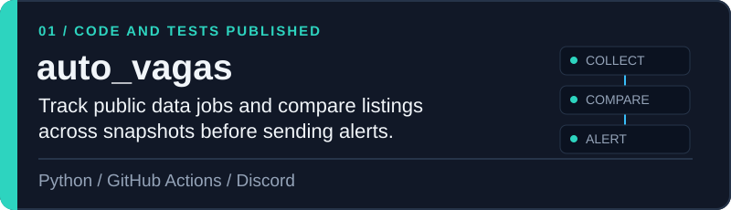
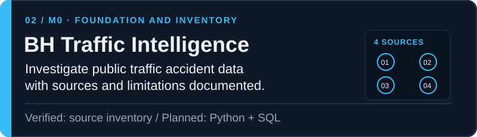
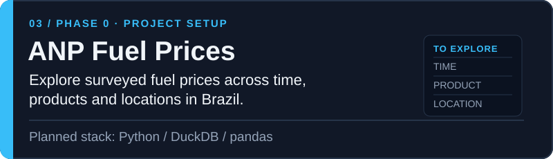

<picture>
  <source media="(max-width: 600px)" srcset="assets/hero-mobile.svg">
  
</picture>

# Luiz Felipe Piumbini

**QA Analyst · Data quality and analytics**

I validate systems and data so that decisions start with reliable information.

[Selected work](#selected-work) · [Portfolio](https://luiizfellipee.github.io/) · [Skills](#skills) · [Experience](#experience) · [Education](#education) · [Contact](#contact)

## About

I work as a QA Analyst, combining system testing with SQL and PostgreSQL checks to investigate behavior and information integrity. I hold a degree in Data Science from FIAP and am building practical work in data analysis. My longer-term goal is to grow into machine learning engineering.

## Selected work

These repositories show both implemented work and projects still taking shape. Each card states what is available today.

<a href="https://github.com/Luiizfellipee/auto_vagas">
  <picture>
    <source media="(max-width: 600px)" srcset="assets/auto-vagas-mobile.svg">
    
  </picture>
</a>

**[auto_vagas](https://github.com/Luiizfellipee/auto_vagas)** · A Python monitor for public data job listings, with snapshot comparison, tests and a scheduled GitHub Actions workflow. The repository documents alerts sent to Discord.

<a href="https://github.com/Luiizfellipee/BH-traffic-intelligence">
  <picture>
    <source media="(max-width: 600px)" srcset="assets/bh-traffic-intelligence-mobile.svg">
    
  </picture>
</a>

**[BH Traffic Intelligence](https://github.com/Luiizfellipee/BH-traffic-intelligence)** · Organizing the sources and data quality questions for an analysis of BHTRANS traffic accident records. Four source collections have been inventoried. The project is in **M0: foundation and inventory**; ingestion, analysis and a dashboard remain planned.

<a href="https://github.com/Luiizfellipee/anp-fuel-prices">
  <picture>
    <source media="(max-width: 600px)" srcset="assets/anp-fuel-prices-mobile.svg">
    
  </picture>
</a>

**[ANP Fuel Prices](https://github.com/Luiizfellipee/anp-fuel-prices)** · Preparing a reproducible exploration of Brazil's surveyed fuel prices by period, product and location. The repository is in **Phase 0: project setup**; data profiling, analysis and a dashboard are future steps.

## Skills

- **Quality and validation:** system testing, consistency checks, issue investigation and information integrity.
- **Data and databases:** SQL, PostgreSQL and Python; data analysis foundations developed through FIAP and portfolio projects.
- **Project tools:** Git and GitHub. The `auto_vagas` repository includes Python tests and a GitHub Actions workflow.

## Experience

As a QA Analyst, I validate system behavior and use SQL and PostgreSQL to examine records and check whether information remains consistent across workflows. This practical quality perspective shapes how I approach data projects: document the source, check assumptions and distinguish verified findings from planned work.

## Education

**Degree in Data Science — FIAP.** My academic background supports my move toward data analysis and, over time, machine learning engineering.

Academic recognition

I was part of the first-place team in the FIAP NEXT Enterprise Challenge for an audio-to-text NPS project, as listed on [my LinkedIn profile](https://www.linkedin.com/in/luiz-felipe-piumbini-366768115/).

## Contact

[Portfolio](https://luiizfellipee.github.io/) · [LinkedIn](https://www.linkedin.com/in/luiz-felipe-piumbini-366768115/) · [GitHub](https://github.com/Luiizfellipee)
